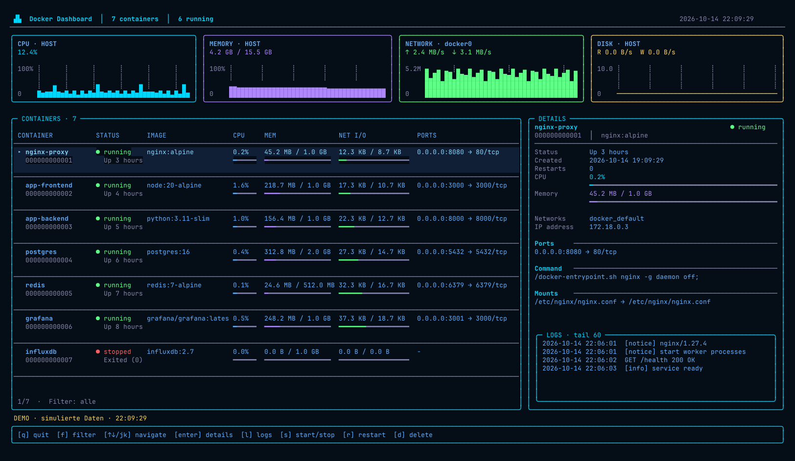

# Docker Dashboard

Ein Docker-Dashboard direkt im Terminal, angelehnt an die Referenz: dunkle
Oberflaeche, vier Live-Diagramme, Container-Tabelle, Detailansicht und Logs.
Python 3.10+ und die Docker CLI genuegen. Keine zusaetzlichen Python-Pakete.



## Starten

Im Projektverzeichnis:

```sh
./docker-dash
```

Die Ansicht aus dem Referenzbild mit sieben simulierten Containern:

```sh
./docker-dash --demo
```

Alternativ: `python3 -m docker_dash`. Fuer die vollstaendige Ansicht mit vier
Diagrammen und Details empfiehlt sich ein Terminal mit **200 Spalten und 54
Zeilen**. Ab 132 Spalten stehen Liste und Details nebeneinander; bei kleineren
Terminals oeffnet Enter die Details. Minimum: 80 × 24. Die Ansicht passt sich
beim Vergroessern und Verkleinern automatisch an.

## Bedienung

| Taste | Funktion |
| --- | --- |
| ↑ / ↓ oder j / k | Container auswaehlen |
| Home / End | Erster / letzter Container |
| f oder / | Nach Name, Image, Status oder ID filtern |
| Enter | Filter uebernehmen / Details umschalten |
| l | Grosse Log-Ansicht umschalten |
| Page Up / Page Down | In den letzten 60 Log-Zeilen scrollen |
| s | Ausgewaehlten Container starten / stoppen |
| r | Ausgewaehlten Container neu starten |
| d | Ausgewaehlten Container entfernen |
| y / n | Aktion bestaetigen / abbrechen |
| Esc | Filter loeschen / Detailansicht schliessen / Aktion abbrechen |
| Leertaste | Aktualisierung anfordern |
| q oder Ctrl+C | Beenden |

Starten, Stoppen, Neustarten und Entfernen werden erst nach Bestaetigung
ausgefuehrt. Entfernen nutzt `docker rm` ohne `--force` oder `--volumes`.
Laufende Container muessen zuerst gestoppt werden. Im Demo-Modus werden
keine Docker-Aktionen ausgefuehrt.

## Daten und Verbindung

Die Containerdaten kommen aus `docker ps`, `docker inspect`, `docker stats`
und `docker logs`. Der aktuell konfigurierte Docker-Kontext sowie
`DOCKER_HOST` werden von der Docker CLI uebernommen. Docker-Befehle laufen
im Hintergrund, damit die Tastatur bedienbar bleibt.

Die oberen CPU-, RAM- und Disk-Diagramme zeigen den **lokalen Linux-Host**
ueber `/proc`. Netzwerk zeigt `docker0`, wenn vorhanden; andernfalls lokale
Uplink-Schnittstellen ohne Loopback, veth und Docker-Bridges. Netzwerk und
Disk zeigen Raten pro Sekunde; die Container-Tabelle zeigt kumulierte
Netzwerk-Zaehler. Auf anderen Unix-Systemen bleibt die Containeransicht
nutzbar, aber die Host-Diagramme sind als nicht verfuegbar markiert. Bei einem
entfernten Docker-Kontext zeigen die Host-Diagramme weiterhin den lokalen
Rechner, die Container-Tabelle den entfernten Docker-Daemon.

Die Anzeige wird standardmaessig alle zwei Sekunden nach Abschluss der
Abfrage aktualisiert. Laengere Docker-Abfragen koennen das Intervall
verlaengern. Verbindungsausfaelle werden angezeigt; vorhandene Daten werden
sichtbar als veraltet markiert.

```sh
./docker-dash --refresh 5
./docker-dash --check
./docker-dash --demo --check
```

`--check` gibt JSON aus und beendet sich mit Exit-Code 0 bei erfolgreicher
Verbindung, sonst mit 1. Bei `permission denied` zuerst `docker ps -a` im
eigenen Terminal pruefen. Der Benutzer braucht Zugriff auf den konfigurierten
Docker-Daemon. Das Dashboard aendert keine Socket-Rechte oder Benutzergruppen.

Die Docker-Befehlsformate orientieren sich an der offiziellen Dokumentation:
[Containerliste](https://docs.docker.com/reference/cli/docker/container/ls/),
[Statistiken](https://docs.docker.com/reference/cli/docker/container/stats/),
[Logs](https://docs.docker.com/reference/cli/docker/container/logs/).

## Tests

```sh
python3 -m unittest discover -s tests -v
```

Die Tests pruefen Datenverarbeitung, Einheiten, Host-Zaehler, Fehlerfaelle,
Filter, Auswahl, Terminalgroessen und die Bestaetigung von Docker-Aktionen.
Dabei werden keine echten Container veraendert.
